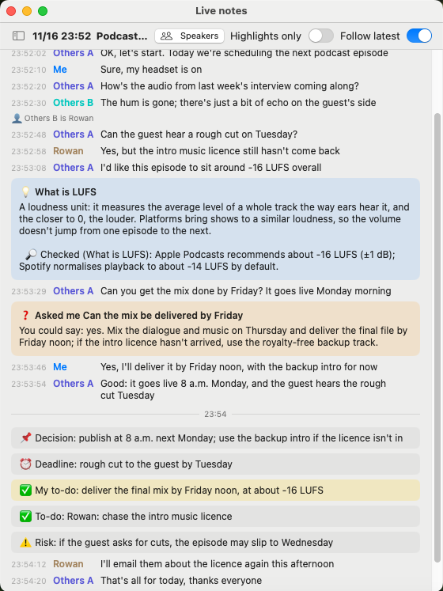
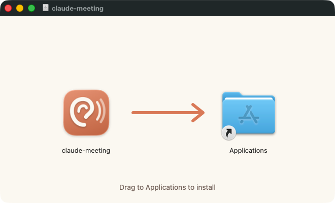
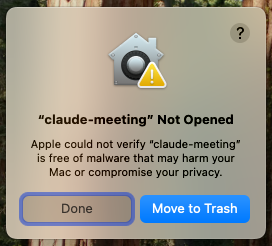
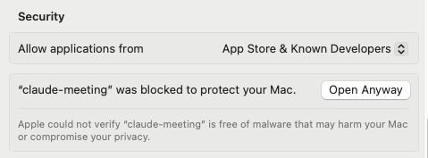
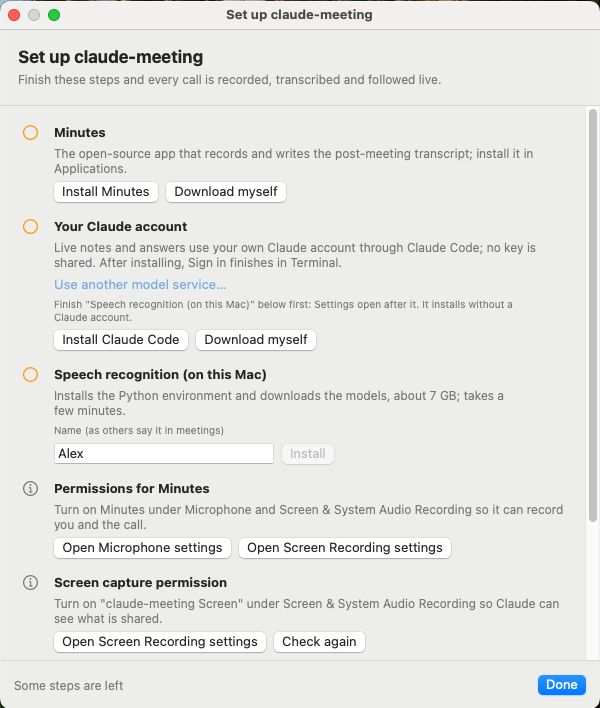
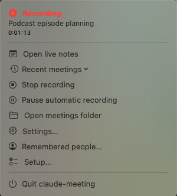

# claude-meeting

[繁體中文](README.zh-TW.md)

*claude-meeting is an independent project. It is not made by, endorsed by or affiliated with Anthropic. Claude is a trademark of Anthropic.*

**A meeting assistant for your Mac.** Join a call in any app and it starts recording by itself. It
transcribes the call live on your Mac and notes the to-dos, decisions and deadlines. When someone asks
you something, it writes an answer you can use.



<sub>A made-up meeting, played with `scripts/demo-meeting.py`. [Watch it fill in live (40 s)](docs/images/demo-en.gif).</sub>

## What it does

- **Records every call by itself.** Zoom, Meet in a browser, Teams, LINE, Slack: when an app starts using
  the microphone, recording starts, and it stops when the call ends.
- **Live transcript per speaker.** Each sentence appears 1–2 seconds after it is said, labelled "me" or
  "others". Other people are told apart by voice and named once known.
- **Live notes.** Every 15 seconds the model picks out to-dos (yours and others'), decisions, deadlines,
  risks and questions put to you, and notifies you about the ones that matter.
- **Instant answers.** A question in the meeting, or a term you may not know, gets an answer within a few
  seconds, checked in the background with a web search.
- **Reads the screen.** Shared slides and documents are turned into text the model can use.
- **After the meeting**: the full transcript and a summary, written by the [Minutes](https://github.com/silverstein/minutes) app.

Speech recognition runs **on your Mac**: Traditional Chinese (tuned for Taiwanese Mandarin mixed with English
terms), Simplified Chinese and English. The notes and answers come from **your own Claude account**, or from any
service that speaks the OpenAI chat format (DeepSeek, Qwen, OpenAI, a model on your Mac).

## What you need

| | |
|---|---|
| Mac | Apple Silicon (M1 or later), 16 GB of memory recommended |
| macOS | 15 Sequoia or later; reading text off the shared screen needs macOS 26 |
| Disk | about 7 GB for the speech models |
| A model | a Claude account (subscription or API) signed in to Claude Code, **or** a key for another service, **or** a model on your Mac |
| Installed for you | [Minutes](https://github.com/silverstein/minutes) (recording) and [Claude Code](https://claude.com/claude-code); the setup guide installs both |

## Install

### 1. Download and drag to Applications

Download `claude-meeting-<version>.dmg` from [Releases](https://github.com/claude-meeting/claude-meeting/releases),
open it and drag claude-meeting onto Applications.



### 2. Open it the first time: "Open Anyway"

claude-meeting is signed by its author but not notarized by Apple (that needs a paid Apple developer account), so
the first time you open it macOS stops it with **"claude-meeting" Not Opened**. Click **Done**, then:

1. Open **System Settings → Privacy & Security** and scroll down to **Security**.
2. Next to *"claude-meeting" was blocked to protect your Mac*, click **Open Anyway**.
3. Click **Open Anyway** again and enter your Mac's password (or use Touch ID).

 

A new version you download may ask again. If you would rather check what you run, the source is all here, and
[docs/development.md](docs/development.md) shows how to build the app yourself.

### 3. Follow the setup guide

The app opens a setup guide that installs what is missing, with progress shown:

- **Minutes**, the open-source recorder.
- **Your model**: install Claude Code and sign in to your Claude account, or choose *Use another model service…*.
- **Speech recognition** (about 7 GB, a few minutes).
- **Permissions**: allow Minutes the Microphone and Screen & System Audio Recording, and switch on
  *claude-meeting Screen* under Screen & System Audio Recording. Some Macs list it as *MeetingCopilotScreen*: that
  is the same helper, not a leftover, and macOS adds it switched off. The guide's buttons open the right page.
- **Your voiceprint**: 30 seconds of you talking, so speech from people near you is not taken for yours.



claude-meeting then lives in the menu bar.

## Your first meeting

Join a call. After a few seconds recording starts, the live notes window opens and the menu bar icon turns red.
The notes that concern you also arrive as notifications. The menu bar icon has everything else: stop or pause
recording, earlier meetings, the people it remembers, settings.



Everything is kept in `~/meetings`: the live notes in `~/meetings/live/`, and the transcript and summary Minutes
writes once the call ends.

## Privacy

**What stays on your Mac.** Audio, screenshots, transcripts and notes, in `~/meetings` (Minutes keeps its own
screenshots in `~/.minutes/screens`), and a video of the shared screen to look back at, in the engine's folder
(`~/Library/Application Support/Meeting Copilot/engine/app/state/video`). Speech recognition and voice recognition
run on your Mac.

**What is sent, and to whom.** To the model you chose, under your own account or key: transcript lines, text read
from the shared screen, changed screen frames as images (to a model that reads images; turn it off with
`[screen] send_images = false`), and the questions to answer. With Claude, answers are also checked with
Claude's web search. The model gets no access to your files. claude-meeting has no server of its own and sends
nothing to its author: no analytics, no crash reports. The setup guide downloads Minutes, Claude Code and the
speech models from where they are published.

**What is remembered.** Your own voiceprint (`~/.config/meeting-copilot/voiceprint.json`) and those of the people
you name (`people.json` beside it), until you remove them: forget a person in the menu's *Remembered people…*.
For each meeting, a few KB of voice features of everyone in it, so speakers can be recognised later: the ones
Minutes keeps (`~/meetings/.*.embeddings`) stay until you set `[retention] voiceprints_days`; the live ones expire
with the live notes. `[privacy] store_voiceprints = false` keeps only your own voiceprint across meetings: other
people are no longer saved or recognised from one meeting to the next (the live ones are still kept with the
meeting's notes, to tell its speakers apart). Change it in Settings, which also tells Minutes.

**For how long.** Audio and screenshots 30 days, the screen video 14, live notes 30 (with the meeting's live voice
features), transcripts a year; then they are moved to the Trash (`~/.Trash/meeting-copilot-retention/`), never deleted outright. Change the days in Settings.

**Tell the people you record.** Recording a conversation may need the other participants' consent where you or
they are; that is your responsibility. `[privacy] consent_reminder = true` reminds you at the start of each
recording.

## Settings

The menu bar icon → **Settings…** covers your name and language, the model, notifications, the microphone, screen
capture and how long things are kept. Every other setting, and the command-line tools, are in
[docs/configuration.md](docs/configuration.md).

## When something is wrong

- **"claude-meeting" Not Opened**: see [step 2](#2-open-it-the-first-time-open-anyway).
- **No recording when a call starts**: the menu should say *Recording*. If it lists a problem, run the setup guide
  again (menu → Setup…): it shows what is missing.
- **No screen text, or "No permission to capture the screen"**: switch on *claude-meeting Screen* (or
  *MeetingCopilotScreen*, as some Macs list it) in System Settings → Privacy & Security → Screen & System Audio
  Recording. Do not remove it: it would ask again at every recording.
- **No notes or answers**: Claude Code must be signed in (the setup guide's *Your Claude account* step), or the
  other service must pass *Test* in Settings.
- Still stuck: [open an issue](https://github.com/claude-meeting/claude-meeting/issues) and attach
  `~/Library/Application Support/Meeting Copilot/engine/app/state/autopilot.log`, after checking it for anything
  private.

## Updating

Drag the new claude-meeting to Applications and open it: when it carries a newer engine, the setup guide opens with
**Update the engine**, and the menu shows a warning until you do. Before 0.1.17 the app was called *Meeting
Copilot*; the new app moves the old one to the Trash and tells you.

## Uninstall

```bash
"$HOME/Library/Application Support/Meeting Copilot/engine/uninstall.sh" --purge
```

That stops the background service and moves the speech models, the settings and the voiceprint recording to the
Trash. Then drag claude-meeting from Applications to the Trash and remove it from System Settings → General →
Login Items. Your meetings in `~/meetings` are never touched, and Minutes stays installed (remove it yourself if
you no longer want it).

## For developers

Installing from a git checkout without the app, building it, how it works and the tests:
[docs/development.md](docs/development.md).

## License

Apache License 2.0 (`LICENSE`). Models and tools it uses keep their own licenses: see
`THIRD_PARTY_NOTICES.md`.
