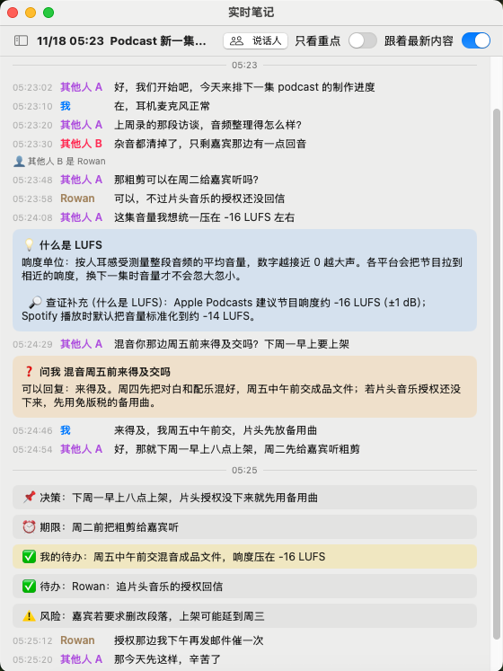
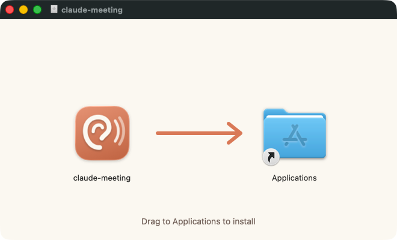
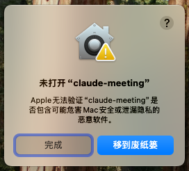
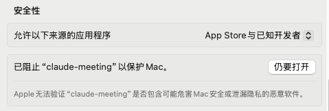
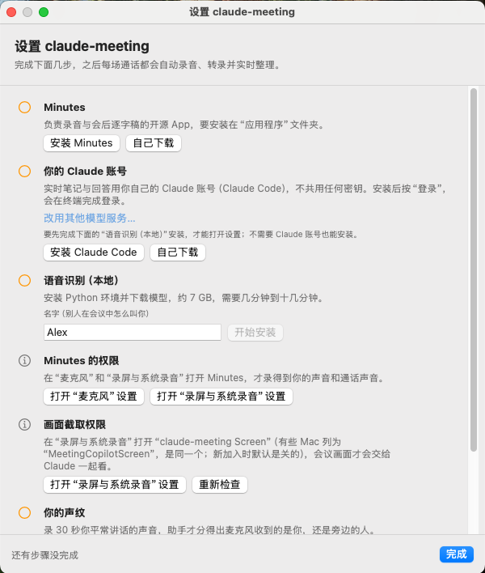
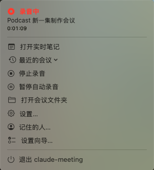

# claude-meeting

[English](README.md) · [繁體中文](README.zh-TW.md)

**Mac 上的会议助手。** 在任何 App 开会，它都会自动开始录音，在你的 Mac 上实时转成逐字稿，记下待办、决策和期限；有人问你问题时，直接写好可以用的回答。



<sub>画面是虚构的演示会议，由 `scripts/demo-meeting.py` 播放。[看它实时写出来的过程（40 秒）](docs/images/demo-cn.gif)。</sub>

## 它会做什么

- **自动录下每场通话**：Zoom、浏览器里的 Meet、Teams、LINE、Slack……任何 App 开始用麦克风就自动录音，通话结束自动停止。
- **分说话人的实时逐字稿**：每句话讲完约 1–2 秒出现，标成“我”或“其他人”；其他与会者按声音分开，知道是谁后改显示名字。
- **实时笔记**：每 15 秒整理出待办（你的、别人的）、决策、期限、风险和问你的问题，跟你有关的会弹出通知。
- **实时回答**：会议中有人提问，或出现你可能不懂的名词，几秒内写出回答，并在后台用网络搜索查证。
- **读取画面**：分享的幻灯片与文档会转成文本，一起交给模型。
- **会后**：由 [Minutes](https://github.com/silverstein/minutes) 产生完整逐字稿与摘要。

语音识别在**你的 Mac 上**运行：繁体中文（针对台湾华语夹英文术语调优）、简体中文与英文。笔记与回答使用**你自己的 Claude 账号**，也可以改接任何支持 OpenAI 兼容格式的服务（DeepSeek、Qwen、OpenAI、本地模型）。

## 需要什么

| | |
|---|---|
| Mac | Apple Silicon（M1 以后），建议 16 GB 内存 |
| macOS | 15 Sequoia 以上；读取分享画面上的文本需要 macOS 26 |
| 磁盘 | 约 7 GB，放语音识别模型 |
| 模型 | 登录 Claude Code 的 Claude 账号（订阅或 API 皆可），**或**其他服务的密钥，**或**本地模型 |
| 会自动安装 | [Minutes](https://github.com/silverstein/minutes)（录音）与 [Claude Code](https://claude.com/claude-code)，设置向导会帮你装 |

## 安装

### 1. 下载，拖到“Applications”（应用程序）

从 [Releases](https://github.com/claude-meeting/claude-meeting/releases) 下载 `claude-meeting-<版本>.dmg`，打开后把 claude-meeting 拖到旁边的“Applications”（应用程序）文件夹。



### 2. 第一次打开：按“仍要打开”

claude-meeting 有作者的签名，但没有经过 Apple 公证（公证需要付费的 Apple 开发者账号），所以第一次打开时 macOS 会挡下来，显示**未打开“claude-meeting”**。按“**完成**”，接着：

1. 打开“**系统设置 → 隐私与安全性**”，滚动到最下面的“**安全性**”。
2. 在“已阻止‘claude-meeting’以保护 Mac”旁边按“**仍要打开**”。
3. 再按一次“**仍要打开**”，输入 Mac 的密码（或用 Touch ID）。

 

之后下载的新版本可能要再做一次。想先确认自己运行的是什么，源代码都在这里，[docs/development.md](docs/development.md) 也写了怎么自己构建 App。

### 3. 照设置向导走

App 会打开设置向导，缺什么就装什么，有进度条：

- **Minutes**：开源的录音程序。
- **你的模型**：安装 Claude Code 并登录你的 Claude 账号，或选“改用其他模型服务…”。
- **语音识别**：约 7 GB，需要几分钟。
- **权限**：允许 Minutes 使用“麦克风”与“录屏与系统录音”，并在“录屏与系统录音”打开“claude-meeting Screen”。有些 Mac 会列为“MeetingCopilotScreen”：那就是同一个辅助程序，不是旧版残留，而且 macOS 加入时默认是关的。向导里的按钮会直接打开对的页面。
- **你的声纹**：录 30 秒你讲话的声音，旁人讲话才不会被当成你。



完成后，claude-meeting 会待在菜单栏。

## 第一场会议

加入通话，几秒后就会开始录音、打开实时笔记窗口，菜单栏图标变成红色；跟你有关的笔记也会弹出通知。其他功能都在菜单栏图标里：停止或暂停录音、之前的会议、记住的人、设置。



所有数据都在 `~/meetings`：实时笔记在 `~/meetings/live/`，通话结束后 Minutes 会再写出逐字稿与摘要。

## 隐私

**留在你 Mac 上的**：录音、截图、逐字稿和笔记，都在 `~/meetings`（Minutes 自己的截图在 `~/.minutes/screens`）；会后回看用的分享画面视频在引擎的文件夹（`~/Library/Application Support/Meeting Copilot/engine/app/state/video`）。语音识别和声纹识别都在你的 Mac 上运行。

**送出去的，送给谁**：以你自己的账号或密钥，送给你选的模型：逐字稿、从分享画面读到的文本、有变化的画面截图（只送给看得懂图片的模型；可以用 `[screen] send_images = false` 关掉），以及要回答的问题。用 Claude 时，回答还会用 Claude 的网络搜索查证。模型无法访问你的文件。claude-meeting 没有自己的服务器，不会传任何东西给作者：没有使用统计，也没有崩溃报告。设置向导会从各自的发布处下载 Minutes、Claude Code 和语音模型。

**会记住的**：你自己的声纹（`~/.config/meeting-copilot/voiceprint.json`）和你命名过的人的声纹（同文件夹的 `people.json`），会保留到你自己删除为止，在菜单的“记住的人…”可以忘记某个人。每场会议还会留下所有人几 KB 的声音特征，之后才认得出说话人：Minutes 保存的那份（`~/meetings/.*.embeddings`）要设 `[retention] voiceprints_days` 才会到期删除；实时转录留下的那份跟着实时笔记一起到期。设 `[privacy] store_voiceprints = false` 之后，跨会议只保留你自己的声纹，其他人不再保存，之后的会议也认不出是谁（实时转录那份仍会跟着该场笔记保留，用来分辨那场的说话人）。在设置里改，会一并应用到 Minutes。

**保存多久**：录音和截图 30 天、画面视频 14 天、实时笔记 30 天（连同该场的实时声音特征）、逐字稿一年；到期后移到废纸篓（`~/.Trash/meeting-copilot-retention/`），不会直接删除。天数可以在设置里改。

**录音前先告知与会者**：录下别人的谈话，根据你或对方所在地的法规可能需要对方同意，这是用户自己的责任。设置 `[privacy] consent_reminder = true`，每次开始录音时会提醒你。

## 设置

菜单栏图标 →“**设置…**”可以改你的名字与语言、模型、通知、麦克风、画面截取和保存天数。其他设置与命令行工具见 [docs/configuration.zh-CN.md](docs/configuration.zh-CN.md)。

## 遇到问题

- **macOS 挡下、打不开**：见[第 2 步](#2-第一次打开按仍要打开)。
- **开会时没有录音**：菜单应该显示“录音中”。如果列出问题，重新运行设置向导（菜单 →“设置向导…”），它会显示缺了什么。
- **读不到画面文本，或通知“画面截取没有权限”**：到“系统设置 → 隐私与安全性 → 录屏与系统录音”打开“claude-meeting Screen”（有些 Mac 列为“MeetingCopilotScreen”）。不要把它移除，否则每次录音都会再问一次。
- **没有笔记或回答**：Claude Code 要先登录（设置向导的“你的 Claude 账号”），或其他服务要在设置里通过“测试连接”。
- 还是不行：[开一个 issue](https://github.com/claude-meeting/claude-meeting/issues)，附上 `~/Library/Application Support/Meeting Copilot/engine/app/state/autopilot.log`（先确认里面没有不想公开的内容）。

## 更新

把新版 claude-meeting 拖到“应用程序”再打开：新版带了较新的引擎时，设置向导会打开并显示“更新引擎”，更新之前菜单也会一直提示。0.1.17 以前 App 叫做 Meeting Copilot，新版会把旧版移到废纸篓并通知你。

## 移除

```bash
"$HOME/Library/Application Support/Meeting Copilot/engine/uninstall.sh" --purge
```

会停止后台服务，并把语音模型、设置和声纹录音移到废纸篓。接着把 claude-meeting 从“应用程序”拖到废纸篓，再到“系统设置 → 通用 → 登录项与扩展”移除它。`~/meetings` 的会议数据一律不动；Minutes 会留着，不要的话请自行移除。

## 开发者

不用 App、从 git 安装，自己构建 App，工作原理与测试：[docs/development.md](docs/development.md)（英文）。

## 许可证

Apache License 2.0（`LICENSE`）。用到的模型与工具各自保留原本的许可证，见 `THIRD_PARTY_NOTICES.md`。
