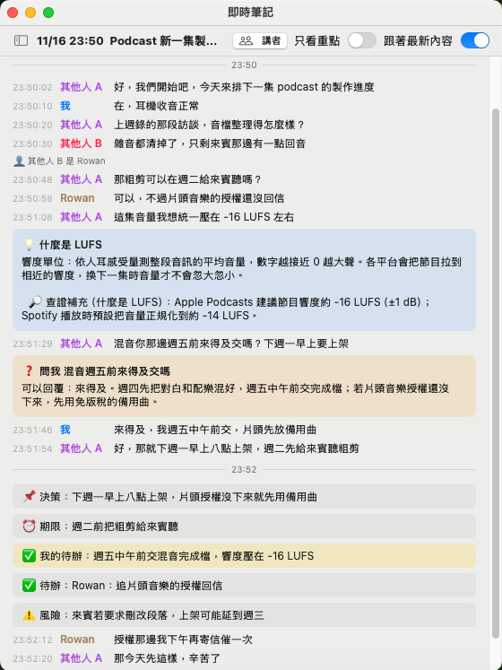
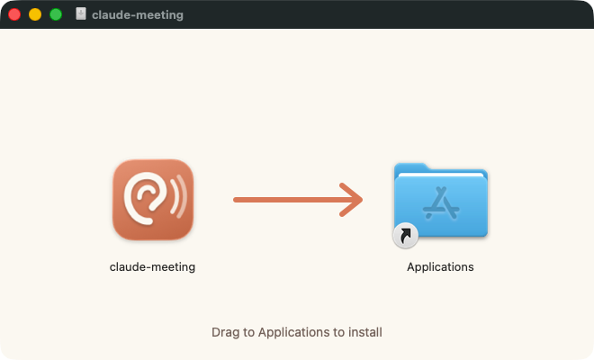
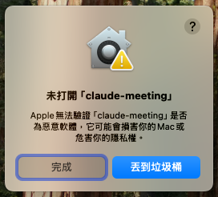
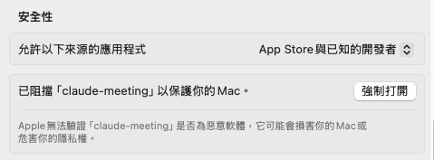
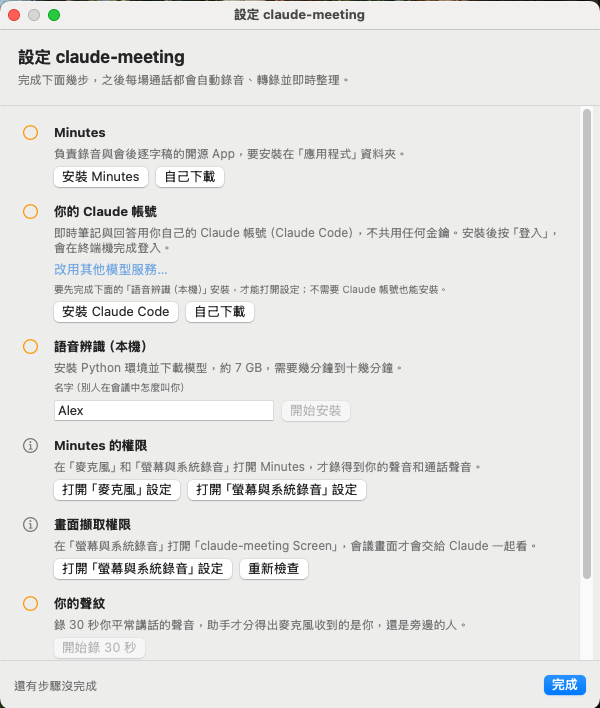
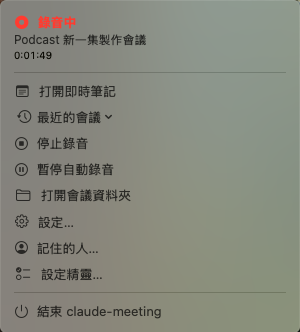

# claude-meeting

[English](README.md) · [简体中文](README.zh-CN.md)

**Mac 上的會議助手。** 在任何 App 開會，它都會自動開始錄音，在你的 Mac 上即時轉成逐字稿，記下待辦、決策和期限；有人問你問題時，直接寫好可以用的回答。



<sub>畫面是虛構的示範會議，由 `scripts/demo-meeting.py` 播放。[看它即時寫出來的過程（40 秒）](docs/images/demo-zh.gif)。</sub>

## 它會做什麼

- **自動錄下每場通話**：Zoom、瀏覽器裡的 Meet、Teams、LINE、Slack……任何 App 開始用麥克風就自動錄音，通話結束自動停止。
- **分講者的即時逐字稿**：每句話講完約 1–2 秒出現，標成「我」或「其他人」；其他與會者依聲音分開，知道是誰後改顯示名字。
- **即時筆記**：每 15 秒整理出待辦（你的、別人的）、決策、期限、風險和問你的問題，跟你有關的會跳通知。
- **即時回答**：會議中有人提問，或出現你可能不懂的名詞，幾秒內寫出回答，並在背景用網路搜尋查證。
- **讀取畫面**：分享的投影片與文件會轉成文字，一起交給模型。
- **會後**：由 [Minutes](https://github.com/silverstein/minutes) 產生完整逐字稿與摘要。

語音辨識在**你的 Mac 上**執行：繁體中文（針對台灣華語夾英文術語調校）、簡體中文與英文。筆記與回答使用**你自己的 Claude 帳號**，也可以改接任何支援 OpenAI 相容格式的服務（DeepSeek、Qwen、OpenAI、本機模型）。

## 需要什麼

| | |
|---|---|
| Mac | Apple Silicon（M1 以後），建議 16 GB 記憶體 |
| macOS | 15 Sequoia 以上；讀取分享畫面上的文字需要 macOS 26 |
| 磁碟 | 約 7 GB，放語音辨識模型 |
| 模型 | 登入 Claude Code 的 Claude 帳號（訂閱或 API 皆可），**或**其他服務的金鑰，**或**本機模型 |
| 會自動安裝 | [Minutes](https://github.com/silverstein/minutes)（錄音）與 [Claude Code](https://claude.com/claude-code)，設定精靈會幫你裝 |

## 安裝

### 1. 下載，拖到「Applications」（應用程式）

從 [Releases](https://github.com/claude-meeting/claude-meeting/releases) 下載 `claude-meeting-<版本>.dmg`，打開後把 claude-meeting 拖到旁邊的「Applications」（應用程式）資料夾。



### 2. 第一次打開：按「強制打開」

claude-meeting 有作者的簽章，但沒有經過 Apple 公證（公證需要付費的 Apple 開發者帳號），所以第一次打開時 macOS 會擋下來，顯示**未打開「claude-meeting」**。按「**完成**」，接著：

1. 打開「**系統設定 → 隱私權與安全性**」，捲到最下面的「**安全性**」。
2. 在「已阻擋「claude-meeting」以保護你的 Mac」旁邊按「**強制打開**」（有些 macOS 版本叫「仍要打開」）。
3. 再按一次「**強制打開**」，輸入 Mac 的密碼（或用 Touch ID）。

 

之後下載的新版本可能要再做一次。想先確認自己跑的是什麼，原始碼都在這裡，[docs/development.md](docs/development.md) 也寫了怎麼自己建置 App。

### 3. 照設定精靈走

App 會打開設定精靈，缺什麼就裝什麼，有進度條：

- **Minutes**：開源的錄音程式。
- **你的模型**：安裝 Claude Code 並登入你的 Claude 帳號，或選「改用其他模型服務…」。
- **語音辨識**：約 7 GB，需要幾分鐘。
- **權限**：允許 Minutes 使用「麥克風」與「螢幕與系統錄音」，並在「螢幕與系統錄音」打開「claude-meeting Screen」。有些 Mac 會列為「MeetingCopilotScreen」：那就是同一個輔助程式，不是舊版殘留，而且 macOS 加入時預設是關的。精靈裡的按鈕會直接打開對的頁面。
- **你的聲紋**：錄 30 秒你講話的聲音，旁人講話才不會被當成你。



完成後，claude-meeting 會待在選單列。

## 第一場會議

加入通話，幾秒後就會開始錄音、打開即時筆記視窗，選單列圖示變成紅色；跟你有關的筆記也會跳通知。其他功能都在選單列圖示裡：停止或暫停錄音、之前的會議、記住的人、設定。



所有資料都在 `~/meetings`：即時筆記在 `~/meetings/live/`，通話結束後 Minutes 會再寫出逐字稿與摘要。

## 隱私

**留在你 Mac 上的**：錄音、截圖、逐字稿和筆記，都在 `~/meetings`（Minutes 自己的截圖在 `~/.minutes/screens`）；會後回看用的分享畫面影片在引擎的資料夾（`~/Library/Application Support/Meeting Copilot/engine/app/state/video`）。語音辨識和聲紋辨識都在你的 Mac 上執行。

**送出去的，送給誰**：以你自己的帳號或金鑰，送給你選的模型：逐字稿、從分享畫面讀到的文字、有變化的畫面截圖（只送給看得懂圖片的模型；可以用 `[screen] send_images = false` 關掉），以及要回答的問題。用 Claude 時，回答還會用 Claude 的網路搜尋查證。模型無法存取你的檔案。claude-meeting 沒有自己的伺服器，不會傳任何東西給作者：沒有使用統計，也沒有當機回報。設定精靈會從各自的發佈處下載 Minutes、Claude Code 和語音模型。

**會記住的**：你自己的聲紋（`~/.config/meeting-copilot/voiceprint.json`）和你命名過的人的聲紋（同資料夾的 `people.json`），會保留到你自己刪除為止，在選單的「記住的人…」可以忘記某個人。每場會議還會留下所有人幾 KB 的聲音特徵，之後才認得出講者：Minutes 保存的那份（`~/meetings/.*.embeddings`）要設 `[retention] voiceprints_days` 才會到期刪除；即時轉錄留下的那份跟著即時筆記一起到期。設 `[privacy] store_voiceprints = false` 之後，跨會議只保留你自己的聲紋，其他人不再保存，之後的會議也認不出是誰（即時轉錄那份仍會跟著該場筆記保留，用來分辨那場的講者）。在設定裡改，會一併套用到 Minutes。

**保存多久**：錄音和截圖 30 天、畫面影片 14 天、即時筆記 30 天（連同該場的即時聲音特徵）、逐字稿一年；到期後移到垃圾桶（`~/.Trash/meeting-copilot-retention/`），不會直接刪除。天數可以在設定裡改。

**錄音前先告知與會者**：錄下別人的談話，依你或對方所在地的法規可能需要對方同意，這是使用者自己的責任。設定 `[privacy] consent_reminder = true`，每次開始錄音時會提醒你。

## 設定

選單列圖示 →「**設定…**」可以改你的名字與語言、模型、通知、麥克風、畫面擷取和保存天數。其他設定與指令列工具見 [docs/configuration.zh-TW.md](docs/configuration.zh-TW.md)。

## 遇到問題

- **macOS 擋下、打不開**：見[第 2 步](#2-第一次打開按強制打開)。
- **開會時沒有錄音**：選單應該顯示「錄音中」。如果列出問題，重新跑設定精靈（選單 →「設定精靈…」），它會顯示缺了什麼。
- **讀不到畫面文字，或通知「畫面擷取沒有權限」**：到「系統設定 → 隱私權與安全性 → 螢幕與系統錄音」打開「claude-meeting Screen」（有些 Mac 列為「MeetingCopilotScreen」）。不要把它移除，否則每次錄音都會再問一次。
- **沒有筆記或回答**：Claude Code 要先登入（設定精靈的「你的 Claude 帳號」），或其他服務要在設定裡通過「測試連線」。
- 還是不行：[開一個 issue](https://github.com/claude-meeting/claude-meeting/issues)，附上 `~/Library/Application Support/Meeting Copilot/engine/app/state/autopilot.log`（先確認裡面沒有不想公開的內容）。

## 更新

把新版 claude-meeting 拖到「應用程式」再打開：新版帶了較新的引擎時，設定精靈會打開並顯示「更新引擎」，更新之前選單也會一直提示。0.1.17 以前 App 叫做 Meeting Copilot，新版會把舊版移到垃圾桶並通知你。

## 移除

```bash
"$HOME/Library/Application Support/Meeting Copilot/engine/uninstall.sh" --purge
```

會停止背景服務，並把語音模型、設定和聲紋錄音移到垃圾桶。接著把 claude-meeting 從「應用程式」拖到垃圾桶，再到「系統設定 → 一般 → 登入項目與延伸功能」移除它。`~/meetings` 的會議資料一律不動；Minutes 會留著，不要的話請自行移除。

## 給開發者

不用 App、從 git 安裝，自己建置 App，運作方式與測試：[docs/development.md](docs/development.md)（英文）。

## 授權

Apache License 2.0（`LICENSE`）。用到的模型與工具各自維持原本的授權，見 `THIRD_PARTY_NOTICES.md`。
